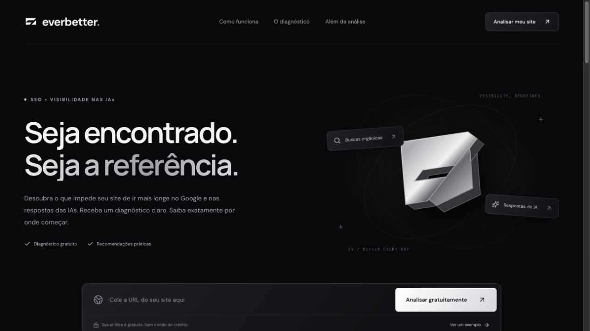

## Visão geral

**EverBetter** é um projeto autoral de **Thalyson Emanuel (TEDSP)**, em produção, para diagnóstico de SEO e preparação de páginas para interpretação por sistemas de IA. A aplicação recebe uma URL pública, inspeciona seu HTML e organiza evidências, prioridades e recomendações em um relatório acessível ao usuário.

**Acessar o projeto:** [betterever.tedsptech.com](https://betterever.tedsptech.com/).

## Contexto e problema

Empresas precisam identificar o que pode melhorar em suas páginas, mas relatórios técnicos nem sempre deixam claro o que foi encontrado, qual ação executar e por onde começar. O EverBetter reúne esses elementos em um diagnóstico organizado por categorias.

## Minha atuação

Projeto autoral com desenvolvimento da interface, identidade visual, inspeção técnica de páginas, integração com modelos de IA, persistência de dados e estrutura de administração e publicação.

## Imagens do projeto

### Página pública em produção

Captura da página pública. O diagnóstico ilustrativo exibido no site é identificado como exemplo, separado das análises de URLs enviadas pelo usuário.

## Stack e arquitetura

| Camada | Tecnologia / recurso | Responsabilidade |
| --- | --- | --- |
| Interface | React e TypeScript | Entrada da URL, apresentação e navegação do relatório |
| Aplicação e servidor | Vinext e Node.js | Rotas HTTP, processamento da análise e operação do painel |
| Inspeção técnica | Parser de HTML e regras próprias | Extração de sinais e geração dos critérios observados |
| Interpretação por IA | OpenRouter | Complementação das recomendações quando a integração está configurada |
| Persistência | SQLite e migrações SQL | Configurações, solicitações de interesse e dados administrativos |
| Publicação | Docker, Coolify e proxy HTTPS | Execução da aplicação e persistência dos dados em produção |

**Fluxo principal:** URL pública → validação e obtenção do HTML → inspeção técnica → interpretação opcional por IA → relatório com evidências e prioridades.

## Componentes e responsabilidades

### 1. Recebimento e inspeção da URL

**Objetivo:** analisar elementos disponíveis no HTML público de uma página.

**Principais funções:** validar a URL, obter o documento e observar títulos, descrições, headings, idioma, canonical, diretivas de indexação, alternativas textuais de imagens, dados estruturados e sinais de contexto e contato.

### 2. Diagnóstico e priorização

**Objetivo:** transformar os sinais encontrados em ações compreensíveis.

**Principais funções:** organizar os critérios em SEO, contexto para IAs, conteúdo e aspectos técnicos; exibir evidências, recomendações, prioridade, esforço e benefício qualitativo esperado.

**Comportamento:** o relatório distingue critérios observados dos que precisam de confirmação. O índice resume verificações da página analisada.

### 3. Interpretação por IA

**Objetivo:** complementar a explicação e as recomendações do diagnóstico.

**Comportamento:** utiliza o OpenRouter quando a integração está configurada. Se a IA não estiver ativa ou o provedor falhar, o usuário recebe a inspeção técnica com indicação do modo utilizado.

### 4. Consulta e compartilhamento do relatório

**Principais funções:** filtros por critérios, cópia e impressão do diagnóstico e acesso a um exemplo ilustrativo para conhecer o funcionamento antes de analisar uma URL.

### 5. Interesse comercial e administração

**Principais funções:** captar solicitações de otimização mediante formulário com consentimento e permitir a configuração de textos, oferta, modelo e instruções de IA em um painel com autenticação própria.

O serviço opcional de execução das melhorias é apresentado separadamente do diagnóstico gratuito. O projeto também apresenta uma oferta de melhoria de design e estudo de concorrência local.

## Decisões técnicas

| Decisão | Motivo e efeito |
| --- | --- |
| Separar inspeção técnica e interpretação por IA | Manter as verificações disponíveis mesmo quando a integração de IA não está ativa |
| Exibir evidência junto da recomendação | Relacionar a ação sugerida ao que foi observado no HTML |
| SQLite com dados persistentes | Manter configurações e solicitações entre publicações da aplicação |
| Painel administrativo próprio | Permitir ajustes de conteúdo e configuração sem editar a interface pública |
| Execução em container | Organizar a publicação e a operação da aplicação na VPS |

## Escopo do diagnóstico

A inspeção é feita sobre o HTML da URL informada, sem executar o JavaScript da página nem rastrear o site inteiro. Não mede Core Web Vitals, backlinks, posições em buscadores ou citações em respostas de IA. A nota é heurística e as recomendações não representam previsão de tráfego ou ranking.

## Entrega

- Aplicação autoral disponível em produção.
- Diagnóstico de URLs públicas com evidências e priorização.
- Integração opcional com IA e continuidade no modo técnico.
- Consulta, cópia e impressão dos relatórios.
- Solicitações de otimização e administração de configurações.
