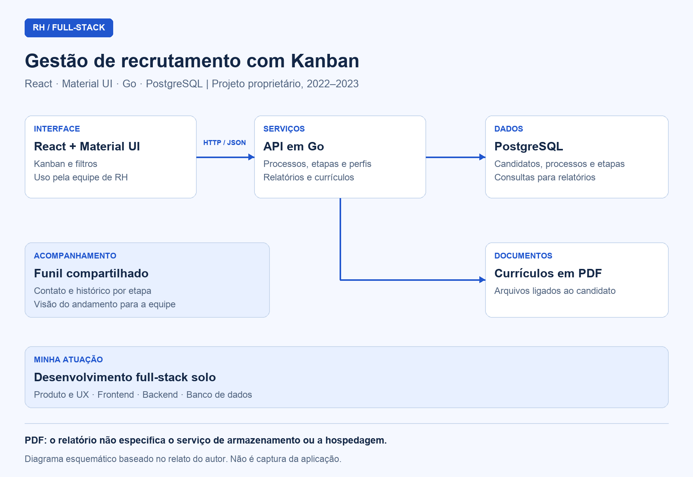

## Visão geral

Sistema de gestão de recrutamento desenvolvido com **React, Material UI, Go e PostgreSQL**. Centraliza processos seletivos, candidatos, currículos em PDF e histórico de contatos em uma interface Kanban compartilhada pela equipe de RH.

O projeto foi desenvolvido entre **2022 e 2023** para uma empresa do setor de assistência familiar. É uma solução proprietária: esta documentação apresenta o funcionamento e as decisões técnicas, sem publicar o código-fonte.

## Contexto e problema

A equipe de RH precisava acompanhar candidatos em diferentes processos seletivos, identificar a etapa de cada contato e consultar currículos sem perder o contexto do recrutamento. Também precisava manter os integrantes da equipe alinhados sobre o andamento dos processos.

A solução reuniu essas atividades em um sistema administrativo com navegação orientada ao funil de contratação, filtros e relatórios.

## Minha atuação

Atuei como **desenvolvedor full-stack solo**, responsável por:

- Design de produto e experiência do usuário.
- Desenvolvimento da interface em React e Material UI.
- Desenvolvimento da API em Go.
- Estruturação do banco de dados PostgreSQL.
- Integração entre interface, regras do recrutamento, dados e currículos.

## Stack e arquitetura

| Camada | Tecnologia / recurso | Responsabilidade |
| --- | --- | --- |
| Interface web | React | Aplicação acessada pela equipe de RH no navegador |
| Componentes de interface | Material UI | Kanban e telas administrativas com apresentação consistente |
| Comunicação | HTTP / JSON | Troca de dados entre a aplicação web e a API |
| Backend | Go | API responsável pelas operações do sistema |
| Persistência | PostgreSQL | Dados de candidatos, processos seletivos e etapas |
| Documentos | Currículos em PDF | Arquivos vinculados ao perfil de cada candidato |

A aplicação web se comunica com a API em Go, que acessa o PostgreSQL e o armazenamento dos currículos. A documentação descreve essa separação de responsabilidades sem especificar um provedor de armazenamento ou hospedagem.

## Diagramas

### Arquitetura do sistema de recrutamento

Diagrama esquemático baseado na descrição do projeto; não é captura da interface.

## Componentes e responsabilidades

### Kanban de processos seletivos

**Objetivo:** permitir que o RH visualize o andamento do recrutamento por etapas.

**Principais funções:**

- Representar cada etapa do processo seletivo em uma coluna.
- Exibir cada candidato como um card.
- Acompanhar a posição dos candidatos ao longo do funil.

**Comportamento:** organiza o recrutamento na mesma lógica utilizada pela equipe, tornando visível em que ponto do processo cada candidato se encontra.

### Filtros administrativos

**Objetivo:** localizar os candidatos relevantes para cada análise.

**Principais funções:** filtrar as informações por processo seletivo, etapa e perfil.

**Comportamento:** permite consultar recortes do recrutamento sem depender apenas da leitura completa do quadro.

### Perfil do candidato e currículos

**Objetivo:** reunir os dados e documentos necessários ao acompanhamento de cada candidato.

**Principais funções:** manter o perfil e permitir o upload de currículos em PDF vinculados ao candidato.

**Comportamento:** associa o documento ao respectivo perfil para consulta durante o processo seletivo.

### Contato e histórico por etapa

**Objetivo:** preservar o contexto das interações com os candidatos.

**Principais funções:** apoiar o contato, registrar as interações e acompanhar o candidato pelas etapas do processo.

**Comportamento:** mantém o histórico relacionado ao recrutamento, permitindo que a equipe consulte o que já ocorreu com cada candidato.

### Relatórios e visão compartilhada

**Objetivo:** consolidar as informações do recrutamento e manter a equipe alinhada.

**Principais funções:** reunir os dados dos candidatos em relatórios e disponibilizar uma visão compartilhada e atualizada dos processos.

**Comportamento:** dá à equipe acesso às informações necessárias para acompanhar o andamento dos processos seletivos.

## Decisões técnicas

| Decisão | Motivo |
| --- | --- |
| **Go no backend** | Tipagem estática, baixo consumo de memória, concorrência nativa e distribuição em binário único foram os critérios informados para a escolha |
| **PostgreSQL** | Candidatos, processos e etapas formam um domínio relacional, adequado a consultas e agregações para relatórios |
| **Material UI** | Componentes consistentes para construir uma interface administrativa densa e simplificar a entrega das telas |
| **UX centrada no Kanban** | A interface representa o próprio funil de contratação, reduzindo a necessidade de aprender uma lógica de navegação diferente da rotina do RH |
| **Interface voltada a usuários não técnicos** | Organização visual e fluxos simplificados para apoiar a execução das tarefas de recrutamento |

## Entrega e resultados

- Sistema de recrutamento com candidatos organizados em etapas por meio de Kanban.
- Filtros por processo, etapa e perfil.
- Currículos em PDF vinculados aos candidatos.
- Histórico de contatos e acompanhamento do processo seletivo.
- Relatórios consolidados e visão compartilhada para a equipe de RH.

O relatório do projeto descreve essas entregas funcionais, sem informar métricas quantitativas de uso ou de redução de tempo.
