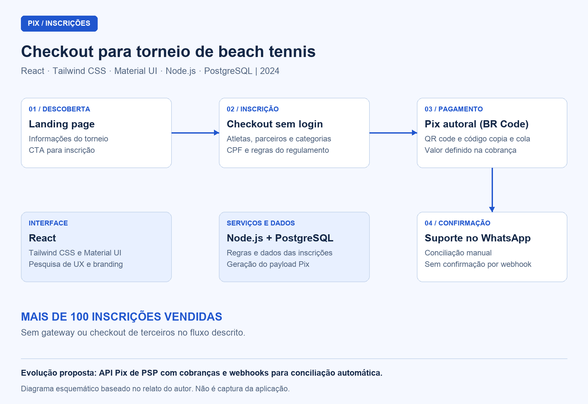

## Visão geral

Checkout de inscrições desenvolvido por **Thalyson Emanuel para a primeira etapa de um torneio internacional de beach tennis, em 2024**. A solução reúne informações do evento, cadastro de múltiplos atletas e categorias e geração autoral de Pix em um fluxo sem login. O projeto registrou **mais de 100 inscrições vendidas**, sem utilizar gateway ou checkout de terceiros.

O pagamento é apresentado por QR code e código Pix copia e cola, com o valor incorporado. A **confirmação e a conciliação são realizadas pela equipe de suporte via WhatsApp**.

Trata-se de um projeto proprietário. Esta documentação apresenta o problema, as funcionalidades e as decisões técnicas; o código-fonte não é público.

## Contexto e problema

Os atletas precisavam se inscrever em uma ou mais categorias e, em muitos casos, cadastrar também seus parceiros de dupla. O processo deveria permitir informar os participantes e efetuar o pagamento sem criar uma conta ou percorrer etapas desnecessárias.

A organização também buscava evitar taxas e dependência de gateways e plataformas de checkout de terceiros. A solução precisava atender ao regulamento do torneio e ao volume e prazo previstos para o evento.

## Minha atuação

Atuação como **desenvolvedor solo**, abrangendo:

- Pesquisa de UX/UI e desenho do fluxo de inscrição e compra.
- Aplicação do branding do torneio, considerando a identidade do esporte e o uso das cores.
- Desenvolvimento do frontend e do backend.
- Estruturação do banco de dados.
- Implementação da geração do código Pix e de sua apresentação ao atleta.

## Stack e arquitetura

| Camada / recurso | Tecnologia | Responsabilidade |
| --- | --- | --- |
| Interface | React | Landing page, formulário de inscrição e apresentação do pagamento |
| Estilos e componentes | Tailwind CSS e Material UI | Aplicação visual do torneio e construção dos componentes de interface |
| Backend | Node.js | Processamento das inscrições e lógica de geração do Pix |
| Banco de dados | PostgreSQL | Persistência dos dados da aplicação |
| Pagamento | Pix com BR Code autoral | Geração do payload com valor incorporado e apresentação em QR code e copia e cola |
| Acompanhamento | Suporte via WhatsApp | Confirmação do pagamento e conciliação manual pela equipe |

O fluxo começa na landing page, segue para o checkout e termina na apresentação do Pix e no encaminhamento ao suporte. A geração do Pix está isolada na arquitetura, permitindo sua evolução sem reestruturar todo o processo de inscrição.

## Diagramas

### Fluxo de inscrição e pagamento

Diagrama esquemático baseado na descrição do projeto; não é captura da interface.

## Componentes e responsabilidades

### 1. Landing page e entrada no checkout

**Objetivo:** apresentar as informações do torneio e conduzir o atleta à inscrição.

**Principais funções:** organizar o conteúdo do evento, aplicar sua identidade visual e disponibilizar a chamada para iniciar a compra.

**Comportamento:** o visitante consulta as informações e acessa o checkout em um caminho contínuo, sem cadastro de conta ou login.

### 2. Checkout de atletas e categorias

**Objetivo:** reunir os dados necessários para inscrever um ou mais atletas nas categorias escolhidas.

**Principais funções:** receber a quantidade de categorias, os dados dos atletas, as escolhas de categorias e o CPF; aplicar as regras derivadas do regulamento do torneio.

**Comportamento:** permite organizar a inscrição do próprio atleta e de seus parceiros de dupla no mesmo fluxo de compra.

### 3. Geração autoral do Pix

**Objetivo:** disponibilizar as informações de pagamento sem um gateway ou checkout externo.

**Principais funções:** montar o payload BR Code com o valor incorporado e apresentá-lo como QR code e código Pix copia e cola.

**Comportamento:** após o preenchimento do checkout, o atleta recebe as duas formas de realizar o pagamento. A apresentação do código, por si só, não representa uma confirmação automática de pagamento.

### 4. Confirmação e conciliação pelo suporte

**Objetivo:** acompanhar o pagamento e concluir a confirmação da inscrição.

**Principais funções:** atender o atleta pelo WhatsApp e realizar a conferência e a conciliação dos pagamentos.

**Comportamento:** a equipe de suporte confirma o pagamento manualmente. Essa responsabilidade operacional faz parte da solução utilizada no evento; a integração com confirmação automática por webhook pertence à evolução planejada.

## Decisões técnicas

| Decisão | Motivo e efeito no projeto |
| --- | --- |
| Fluxo sem login | Reduzir as etapas entre a consulta ao evento e a realização da inscrição |
| Checkout com múltiplos atletas e categorias | Atender inscrições individuais e de parceiros de dupla conforme o regulamento |
| Geração autoral do BR Code | Apresentar o Pix com o valor da compra sem recorrer a um gateway ou checkout de terceiros |
| Confirmação manual via WhatsApp | Atender ao volume e ao prazo do evento, assumindo a conciliação como trabalho da equipe de suporte |
| Geração do Pix isolada na arquitetura | Permitir substituir ou ampliar o mecanismo de cobrança sem refazer todo o fluxo |
| Pesquisa de UX/UI e aplicação do branding | Organizar um fluxo de compra claro e coerente com a identidade do torneio |

## Resultados

- **Mais de 100 inscrições vendidas**, conforme o relato do projeto.
- Inscrição de múltiplos atletas e categorias em um fluxo sem login.
- Pix disponibilizado em QR code e copia e cola, com o valor da compra incorporado.
- Operação sem taxas de gateway ou checkout de terceiros, com confirmação e conciliação manual pelo suporte.

## Evolução planejada

Para volumes maiores, a evolução prevista é integrar a **API Pix de um PSP**, utilizando cobranças dinâmicas e webhooks para confirmar os pagamentos automaticamente e eliminar a conciliação manual.

Essa integração é uma proposta de evolução, e não uma funcionalidade declarada como implementada no projeto documentado. Como a geração do Pix já está isolada, a alteração seria concentrada nessa parte da solução.
