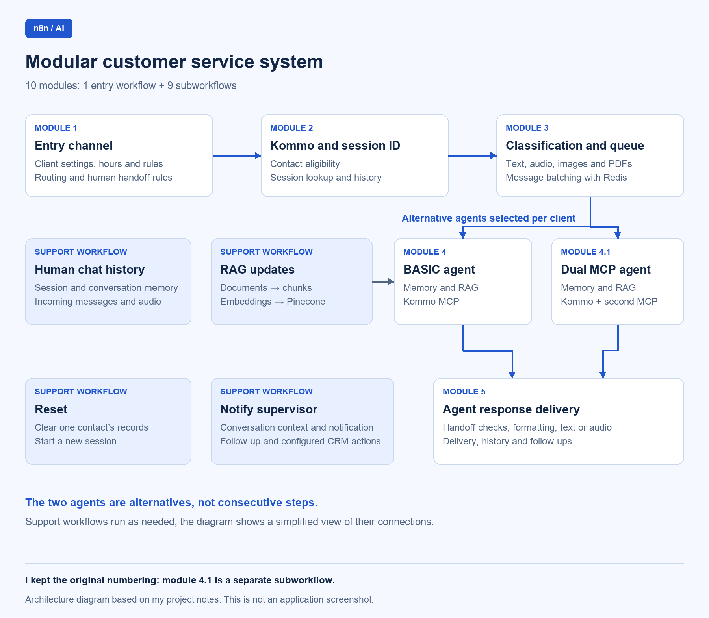
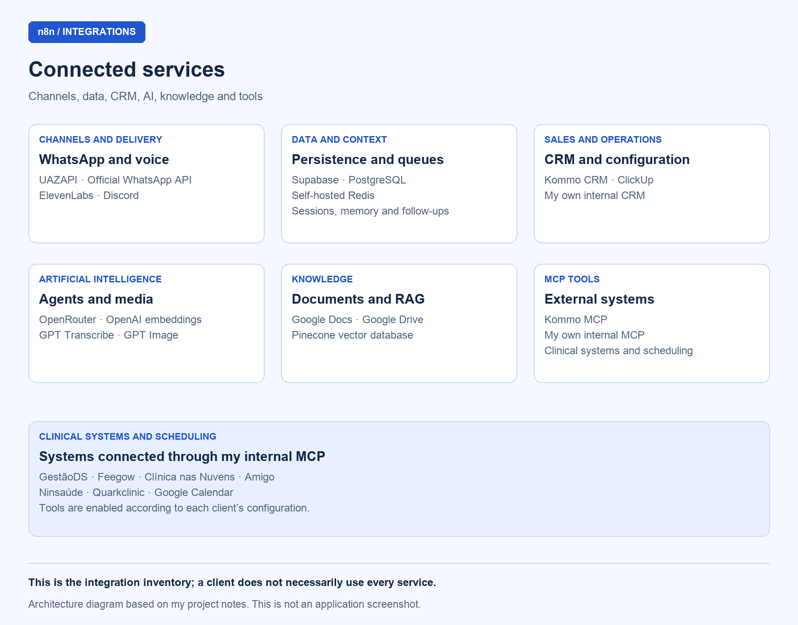

# AI customer service workflows with n8n and MCP

## Overview

I built this customer service automation in **n8n**, using **10 modules: 1 entry workflow and 9 subworkflows**. It receives messages, checks whether a contact is eligible for automated service, processes different types of media, runs AI agents and delivers responses. It also maintains conversation sessions and history, updates the knowledge base and hands conversations over to human staff.

I split these responsibilities across workflows so the service can be configured for each client. The **BASIC Agent** and the **Dual MCP Agent** are alternatives selected through configuration; they are not two mandatory, consecutive steps.

This documentation describes the functional architecture and the behavior of each module. The diagrams are schematic representations of that architecture.

## Diagrams

### 1. Architecture and flow of the 10 modules

Schematic diagram of the main flow, the alternative agent configurations and the supporting modules.

### 2. Integration map

Map of the services connected to the customer service system.

## Module inventory

| No. | Module / workflow | Responsibility |
| --- | --- | --- |
| 1 | Entry channel | Message reception, client configuration and initial routing |
| 2 | Kommo and session ID | CRM eligibility checks and session identification |
| 3 | Message classification and queue | Media normalization and grouping consecutive messages |
| 4 | BASIC Service Agent | Conversations using memory, RAG and the Kommo MCP |
| 4.1 | Dual MCP Agent | Conversations with access to two MCP tool services |
| 5 | Agent response delivery | Preparing and sending responses through the selected channel |
| Support | Notify supervisor | Sending a human supervisor the context needed to follow up |
| Support | Update RAG | Ingesting documents into the knowledge base |
| Support | Reset | Resetting one contact's conversation records |
| Support | Record human conversation history | Preserving conversations outside the automated response flow |

I have kept the original workflow numbering: **4.1 is a separate subworkflow**. Modules 2, 3, 4, 4.1 and 5, together with the four supporting modules, make up the nine subworkflows.

## Integrations

| Area | Services and systems |
| --- | --- |
| Messaging | UAZAPI and the official WhatsApp API |
| Persistence and context | Supabase, PostgreSQL and self-hosted Redis |
| CRM and operations | Kommo CRM, ClickUp and an internal CRM I developed |
| Agents and media | OpenRouter, OpenAI, GPT Image, GPT Transcribe and ElevenLabs |
| Knowledge and documents | Pinecone, OpenAI embeddings, Google Docs and Google Drive |
| Tools | Kommo MCP and an internally developed MCP |
| Clinical systems and scheduling through the internal MCP | GestãoDS, Feegow, Clínica nas Nuvens, Amigo, Ninsaúde, Quarkclinic and Google Calendar |
| Notifications and follow-up | WhatsApp and Discord |

Which integrations are used depends on the module and each client's configuration. The inventory includes **GPT Image and the internal CRM**, but this documentation does not assign them to a specific module. The entry channel is prepared for the official WhatsApp API; other modules include specific paths for that API.

## Module documentation

### Module 1 — Entry channel

Original n8n entry workflow screenshot. The workflow labels remain in Portuguese.

**Purpose:** centralize incoming messages and control their entry into automated service.

**Integrations:** WhatsApp through UAZAPI, ClickUp, Redis, Supabase, OpenAI and other n8n workflows. The structure is also prepared for the official WhatsApp API.

**Main functions:**

- Identify the client and load their service configuration.
- Filter out group messages and automated messages.
- Apply operating-hour rules and check the agent's status.
- Manage blocks while human staff handle a conversation and update follow-ups.
- Organize message data and process audio and images on the paths used to record conversation history.

**Behavior:** receives a message and decides whether to route it to automated service, conversation history or a conversation reset.

### Module 2 — Kommo and session ID

Original n8n workflow screenshot for Kommo and session identification. The workflow labels remain in Portuguese.

**Purpose:** check whether a contact is eligible for service and maintain the conversation's session ID.

**Integrations:** Kommo CRM, Supabase, UAZAPI, OpenAI and other n8n workflows.

**Main functions:**

- Look up contacts and leads in the CRM.
- Check pipeline stages that restrict service and existing conversation blocks.
- Retrieve or create the session.
- Transcribe audio, analyze images and record messages.

**Behavior:** links the message to the corresponding contact and session. Depending on CRM conditions and existing blocks, it sends the conversation to classification and queuing or only records it in the history.

### Module 3 — Message classification and queue

Original n8n message classification and queue workflow screenshot. The workflow labels remain in Portuguese.

**Purpose:** turn different message formats into content the agent can use and group messages sent in quick succession.

**Integrations:** Redis, OpenAI, UAZAPI, the official WhatsApp API and other n8n workflows.

**Main functions:**

- Identify text, audio, images and documents.
- Download media, transcribe audio, interpret images and extract text from PDFs.
- Manage the message queue and wait for the configured interval.
- Select the service model according to the client's configuration.

**Behavior:** converts incoming content into text and groups consecutive messages. Once the content has been consolidated, it sends the request to either the BASIC Agent or the Dual MCP Agent.

### Module 4 — BASIC Service Agent

**Purpose:** conduct AI-assisted conversations using conversation context, client instructions and tools.

**Integrations:** OpenRouter, Google Docs, Google Drive, Supabase, PostgreSQL, Pinecone, OpenAI embeddings and Kommo through MCP.

**Main functions:**

- Load the agent's instructions and consult a backup of the prompt.
- Retrieve conversation memory and search the knowledge base.
- Use CRM tools and perform calculations.
- Request intervention from a supervisor.
- Update the instruction backup and add documents to the knowledge base through the designated routines.

**Behavior:** interprets the request and produces a response using the conversation history, instructions and available information. It passes the response to the delivery module.

### Module 4.1 — Dual MCP Agent

**Purpose:** conduct AI-assisted conversations with access to two MCP tool services.

**Integrations:** OpenRouter, Google Docs, Supabase, PostgreSQL, Pinecone, OpenAI embeddings, Kommo through MCP and a second, configurable MCP service.

**Main functions:**

- Load instructions and retrieve conversation history.
- Query the knowledge base.
- Use tools from both MCP services and perform calculations.
- Notify the supervisor and manage processing attempts.

**Behavior:** combines conversation context with tools from the CRM and the second connected system. The internal MCP provides access to clinical systems, patient records and scheduling tools according to the client's configuration. The response then goes to the delivery module.

### Module 5 — Agent response delivery

**Purpose:** prepare the agent's response and deliver it to the user.

**Integrations:** UAZAPI, the official WhatsApp API, Redis, Supabase, PostgreSQL, OpenRouter, ElevenLabs and Discord.

**Main functions:**

- Check whether automated service is blocked because human staff are handling the conversation.
- Format responses and split long text into smaller messages.
- Generate audio and send messages through the selected channel.
- Check for newly received messages.
- Update conversation history and follow-ups.

**Behavior:** adapts the response to the format and channel, delivering text in parts or as audio. Before certain sends, it checks whether the user has sent a new message so it does not continue a response that is no longer relevant to the conversation.

### Supporting module — Notify supervisor

**Purpose:** send the responsible human staff member information about a conversation that needs follow-up or intervention.

**Integrations:** PostgreSQL, Supabase, OpenRouter, UAZAPI, the official WhatsApp API, Kommo CRM and Discord.

**Main functions:**

- Receive supervision requests and retrieve the conversation history.
- Generate a notification with the relevant context and alert the responsible staff.
- Update follow-up tracking.
- Move leads between pipeline stages in the configured scenarios.

**Behavior:** gathers the context and notifies the supervisor through the selected channel. Where configured, it updates the contact's CRM stage to reflect the handoff or appointment.

### Supporting module — Update RAG

**Purpose:** populate the knowledge base used by the agents.

**Integrations:** Google Drive, OpenAI embeddings and Pinecone, with a client-specific configuration path using ClickUp.

**Main functions:**

- Download documents and load their content.
- Split text into chunks.
- Generate vector representations using embeddings.
- Insert the information into the knowledge base.

**Behavior:** processes reference documents and makes them available for semantic search. Agents use this client-specific information when preparing responses.

### Supporting module — Reset

**Purpose:** reset the conversation records for a specific contact.

**Integrations:** PostgreSQL, Redis and UAZAPI.

**Main functions:**

- Delete conversation memory and remove chat and message records.
- Remove the contact's session association.
- Update a temporary control value in Redis.
- Send a confirmation.

**Behavior:** clears records linked to the supplied phone number so a new session can begin. Deletion is limited to the contact passed to the module.

### Supporting module — Record human conversation history

**Purpose:** preserve message context while human staff handle a conversation or when it is outside the automated response flow.

**Integrations:** Supabase, PostgreSQL, UAZAPI and OpenAI.

**Main functions:**

- Retrieve or create the contact's session.
- Prepare messages in the format used by conversation memory.
- Transcribe audio on the implemented processing paths.
- Save the history and update conversation records.

**Behavior:** records messages received through the paths designated for conversation history, preserving context for later queries and conversations. When audio arrives through the implemented paths, it is converted to text before being saved.

## Behavior across modules

- **Client-specific configuration:** instructions, operating hours, channel, agent and available tools.
- **Context continuity:** sessions, conversation memory and records of both AI and human conversations.
- **Service controls:** CRM eligibility, blocks for human intervention and agent status.
- **Multimodal processing:** text, audio, images and documents converted through the designated processing paths.
- **Queue and context updates:** grouping consecutive messages and checking for new messages before certain sends.
- **Knowledge and tools:** RAG, MCP tools and external system integrations.
- **Follow-up:** follow-up tracking, supervision and configured CRM actions.
