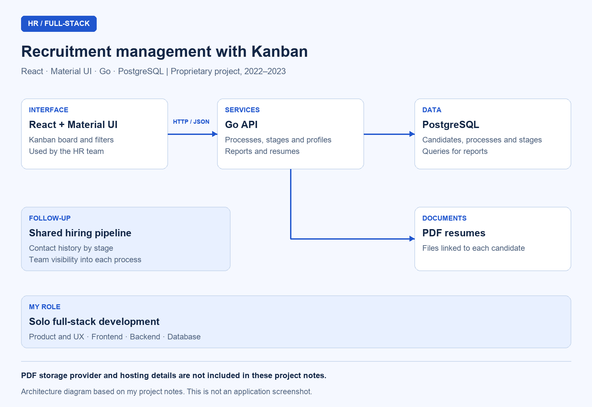

# Recruitment Management System with Kanban, React, Go, and PostgreSQL

## Overview

I built a recruitment management system with **React, Material UI, Go, and PostgreSQL**. I brought hiring processes, candidates, PDF resumes, and contact history together in a Kanban interface shared by the HR team.

I developed the project between **2022 and 2023** for a company in the family-assistance services sector. It is a proprietary application, so I describe its functionality and my technical decisions without publishing the source code.

## Context and problem

The HR team needed to track candidates across multiple hiring processes, identify each candidate's current stage, and review resumes without losing the context of the recruitment process. Team members also needed a shared understanding of each process's progress.

I addressed those needs with an administrative system organized around the hiring pipeline, with filters and reports.

## My role

I worked as the **sole full-stack developer**. I handled product design and UX, built the React and Material UI interface, and implemented the Go API. I also designed the PostgreSQL database and connected the interface to the recruitment rules, data, and resumes.

## Stack and architecture

| Layer | Technology / resource | How I used it |
| --- | --- | --- |
| Web interface | React | Built the application the HR team accessed in the browser |
| UI components | Material UI | Created a consistent Kanban board and administrative screens |
| Communication | HTTP / JSON | Connected the web application to the API |
| Backend | Go | Implemented the API that handled the system's operations |
| Persistence | PostgreSQL | Organized candidate, hiring process, and stage data |
| Documents | PDF resumes | Linked uploaded files to each candidate's profile |

I separated the web application from the Go API, which accesses PostgreSQL and resume storage. The diagram shows those responsibilities without specifying a storage or hosting provider.

## Diagrams

### Recruitment system architecture

I use this schematic to show the architecture; it is not a screenshot of the application.

## Components and responsibilities

### Recruitment Kanban board

I organized recruitment as a Kanban board so the team could see progress by stage. Each column represents a stage, and each card represents a candidate, making it possible to track candidates throughout the hiring pipeline.

I based the interface on the HR team's existing workflow: the board shows where each candidate stands in the process.

### Administrative filters

I implemented filters by hiring process, stage, and profile to help the team find candidates and review specific parts of the pipeline without having to scan the entire board.

### Candidate profiles and resumes

I brought the data and documents needed to follow each candidate into a dedicated profile. I added PDF resume uploads and linked each document to the corresponding profile for review during recruitment.

### Contact history and stage tracking

I added features to support candidate contact, record interactions, and track candidates through the process. I kept that history associated with recruitment so team members could review what had already happened with each candidate.

### Reports and shared visibility

I built reports that consolidate candidate data and a shared, up-to-date view of the hiring processes. My aim was to give the team the information needed to track recruitment and keep everyone aligned.

## Technical decisions

| Decision | Why I chose it |
| --- | --- |
| **Go backend** | I considered static typing, low memory usage, built-in concurrency, and single-binary distribution |
| **PostgreSQL** | I was working with a relational domain — candidates, processes, and stages — and queries and aggregations for reports |
| **Material UI** | I used consistent components to build the administrative screens and simplify their implementation |
| **Kanban-centered UX** | I modeled the interface on the hiring pipeline so navigation would follow the HR team's workflow |
| **An interface for nontechnical users** | I prioritized visual organization and straightforward flows for recruitment tasks |

## Delivery and results

I delivered:

- A recruitment system with candidates organized by stage on a Kanban board.
- Filters by hiring process, stage, and profile.
- PDF resumes linked to candidates.
- Contact history and hiring process tracking.
- Consolidated reports and a shared view for the HR team.

I present these functional deliverables without claiming quantitative usage or time-saving metrics for the project.
