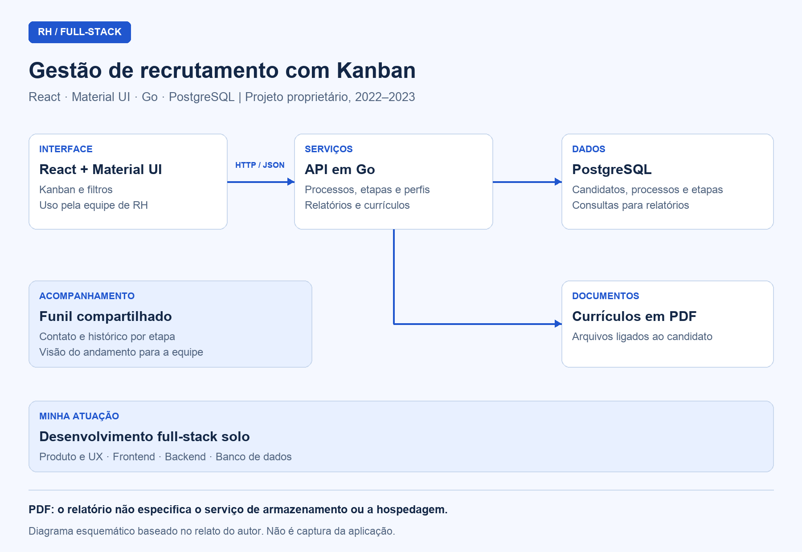

# Sistema de Gestão de Recrutamento com Kanban, React, Go e PostgreSQL

## Visão geral

Desenvolvi um sistema de gestão de recrutamento com **React, Material UI, Go e PostgreSQL**. Reuni processos seletivos, candidatos, currículos em PDF e histórico de contatos em uma interface Kanban compartilhada pela equipe de RH.

Construí o projeto entre **2022 e 2023** para uma empresa do setor de assistência familiar. Como é uma aplicação proprietária, apresento seu funcionamento e minhas decisões técnicas sem publicar o código-fonte.

## Contexto e problema

A equipe de RH precisava acompanhar candidatos em diferentes processos seletivos, identificar a etapa de cada contato e consultar currículos sem perder o contexto do recrutamento. Também precisava manter os integrantes da equipe alinhados sobre o andamento dos processos.

Para atender a essa rotina, reuni essas atividades em um sistema administrativo com navegação orientada ao funil de contratação, filtros e relatórios.

## Minha atuação

Atuei como **desenvolvedor full-stack solo**. Fui responsável pelo design de produto e pela experiência do usuário, desenvolvi a interface em React e Material UI e implementei a API em Go. Também estruturei o banco PostgreSQL e integrei a interface às regras do recrutamento, aos dados e aos currículos.

## Stack e arquitetura

| Camada | Tecnologia / recurso | Como utilizei |
| --- | --- | --- |
| Interface web | React | Desenvolvi a aplicação acessada pela equipe de RH no navegador |
| Componentes de interface | Material UI | Construí o Kanban e as telas administrativas com uma apresentação consistente |
| Comunicação | HTTP / JSON | Integrei a aplicação web à API |
| Backend | Go | Implementei a API responsável pelas operações do sistema |
| Persistência | PostgreSQL | Organizei os dados de candidatos, processos seletivos e etapas |
| Documentos | Currículos em PDF | Vinculei os arquivos ao perfil de cada candidato |

Separei a aplicação web da API em Go, que acessa o PostgreSQL e o armazenamento dos currículos. No diagrama, apresento essas responsabilidades sem detalhar um provedor de armazenamento ou de hospedagem.

## Diagramas

### Arquitetura do sistema de recrutamento

Apresento a arquitetura em um diagrama esquemático; a imagem não é uma captura da interface.

## Componentes e responsabilidades

### Kanban de processos seletivos

Organizei o recrutamento em um Kanban para que a equipe pudesse visualizar o andamento por etapas. Representei cada etapa em uma coluna e cada candidato em um card, permitindo acompanhar sua posição ao longo do funil.

Usei a própria lógica de trabalho do RH como referência para a interface: o quadro mostra em que ponto do processo cada candidato se encontra.

### Filtros administrativos

Implementei filtros por processo seletivo, etapa e perfil para facilitar a localização de candidatos e a consulta de recortes do recrutamento, sem depender da leitura completa do quadro.

### Perfil do candidato e currículos

Reuni os dados e documentos necessários ao acompanhamento em um perfil por candidato. Incluí o upload de currículos em PDF e vinculei cada documento ao respectivo perfil para consulta durante o processo seletivo.

### Contato e histórico por etapa

Incluí recursos para apoiar o contato, registrar as interações e acompanhar o candidato pelas etapas do processo. Mantive esse histórico associado ao recrutamento para que a equipe pudesse consultar o que já havia ocorrido em cada atendimento.

### Relatórios e visão compartilhada

Desenvolvi relatórios que consolidam os dados dos candidatos e uma visão compartilhada e atualizada dos processos. Meu objetivo foi dar à equipe as informações necessárias para acompanhar o recrutamento e manter seus integrantes alinhados.

## Decisões técnicas

| Decisão | Por que escolhi |
| --- | --- |
| **Go no backend** | Considerei a tipagem estática, o baixo consumo de memória, a concorrência nativa e a distribuição em binário único |
| **PostgreSQL** | Trabalhei com um domínio relacional — candidatos, processos e etapas — e consultas e agregações para os relatórios |
| **Material UI** | Usei componentes consistentes para construir as telas administrativas e simplificar sua implementação |
| **UX centrada no Kanban** | Modelei a interface a partir do funil de contratação para que a navegação acompanhasse a rotina do RH |
| **Interface voltada a usuários não técnicos** | Priorizei organização visual e fluxos simplificados para as tarefas de recrutamento |

## Entrega e resultados

Entreguei:

- Um sistema de recrutamento com candidatos organizados por etapas em um Kanban.
- Filtros por processo, etapa e perfil.
- Currículos em PDF vinculados aos candidatos.
- Histórico de contatos e acompanhamento do processo seletivo.
- Relatórios consolidados e uma visão compartilhada para a equipe de RH.

Apresento essas entregas funcionais sem atribuir ao projeto métricas quantitativas de uso ou de redução de tempo.
