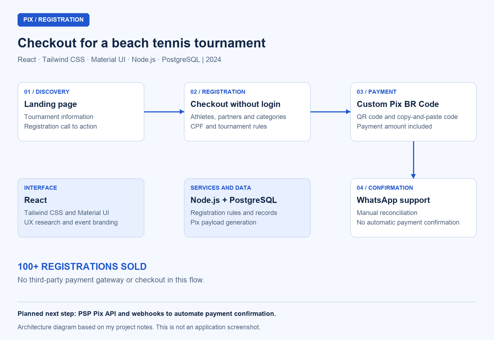

# Pix Checkout for an International Beach Tennis Tournament — Multiple Athletes and Categories

## Overview

I built the registration checkout for the first stage of an **international beach tennis tournament in 2024**. I brought event information, registration for multiple athletes and categories, and in-house Pix generation into a flow that required no login. The project supported **more than 100 tournament registrations sold** without a third-party payment gateway or checkout platform.

I presented payment as a QR code and a copy-and-paste Pix code with the amount included. The **support team confirmed and reconciled payments through WhatsApp**.

It is a proprietary project, so I describe the problem, functionality, and my technical decisions without publishing the source code.

## Context and problem

Athletes needed to enter one or more tournament categories and, in many cases, register their doubles partners as well. They needed to provide participant information and pay without creating an account or going through unnecessary steps.

The organizers also wanted to avoid fees and dependence on third-party payment gateways and checkout platforms. I developed the flow around the tournament rules, expected volume, and event timeline.

## My role

I worked as the **sole developer**. I researched UX/UI and designed the registration and purchase flow, applied the tournament's branding with attention to the sport's identity and use of color, and built the frontend and backend. I also designed the database and implemented Pix code generation and its presentation to athletes.

## Stack and architecture

| Layer / resource | Technology | How I used it |
| --- | --- | --- |
| Interface | React | Built the landing page, registration form, and payment screen |
| Styling and components | Tailwind CSS and Material UI | Applied the tournament's visual identity and built the interface components |
| Backend | Node.js | Implemented registration processing and Pix generation logic |
| Database | PostgreSQL | Designed persistence for the application's data |
| Payment | Pix with an in-house BR Code implementation | Generated the payload with the amount included and presented it as a QR code and a copy-and-paste code |
| Follow-up | WhatsApp support | Routed payment confirmation and manual reconciliation to the support team |

I organized the flow from the landing page to checkout, followed by the Pix payment screen and support handoff. I isolated Pix generation in the architecture so it could evolve without restructuring the entire registration process.

## Diagrams

### Registration and payment flow

I use this schematic to show the flow; it is not a screenshot of the application.

## Components and responsibilities

### 1. Landing page and checkout entry

I organized the tournament information, applied its visual identity, and added the call to action that started the purchase. I connected event information and checkout in one continuous path, with no account creation or login.

### 2. Athlete and category checkout

I built the form to collect the number of categories, athlete information, category selections, and CPF, Brazil's individual taxpayer ID. I applied rules from the tournament regulations and allowed athletes to register themselves and their doubles partners within the same purchase flow.

### 3. In-house Pix generation

I implemented BR Code payload generation with the amount included, without an external payment gateway or checkout platform. After checkout was completed, I presented the athlete with a QR code and a copy-and-paste Pix code as two ways to make the payment.

I kept code presentation separate from payment confirmation: generating or displaying a Pix code did not automatically confirm that payment had been made.

### 4. Support-led confirmation and reconciliation

I routed payment follow-up to the support team through WhatsApp. The team assisted athletes, checked and reconciled payments, and manually confirmed registrations.

I chose that flow for the event's expected volume and timeline. Automatic webhook confirmation remained a planned improvement rather than part of the implementation used for the event.

## Technical decisions

| Decision | Why I chose it and how I applied it |
| --- | --- |
| No-login flow | Reduced the steps between reviewing event information and registering |
| Checkout for multiple athletes and categories | Supported individual and doubles-partner registrations under the tournament rules |
| In-house BR Code generation | Presented Pix payment with the purchase amount without a third-party gateway or checkout platform |
| Manual confirmation through WhatsApp | Matched the operation to the event's volume and timeline, with reconciliation handled by the support team |
| Isolated Pix generation | Separated the payment mechanism so it could be replaced or extended without rebuilding the whole flow |
| UX/UI research and branding | Organized the purchase flow around the tournament's identity and registration requirements |

## Results

- Supported **more than 100 tournament registrations sold**.
- Brought multiple athletes and categories into a registration flow with no login.
- Provided Pix payment through a QR code and a copy-and-paste code with the purchase amount included.
- Implemented an operation with no third-party gateway or checkout fees, with manual confirmation and reconciliation by support.

## Planned improvement

For higher volumes, I would integrate a **payment service provider's Pix API**, using dynamic payment requests and webhooks to confirm payments automatically and remove manual reconciliation.

I did not implement that integration in the project presented here. Because I already isolated Pix generation, I would focus the change on that part of the system while preserving the rest of the registration flow.
