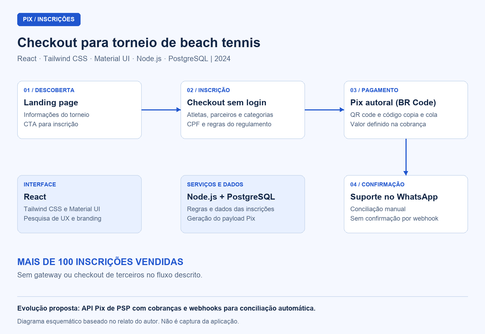

# Checkout Pix para Torneio Internacional de Beach Tennis — múltiplos atletas e categorias

## Visão geral

Desenvolvi o checkout de inscrições para a primeira etapa de um **torneio internacional de beach tennis, em 2024**. Reuni informações do evento, cadastro de múltiplos atletas e categorias e geração autoral de Pix em um fluxo sem login. Com o projeto, foram vendidas **mais de 100 inscrições**, sem utilizar gateway ou checkout de terceiros.

Apresentei o pagamento por QR code e código Pix copia e cola, com o valor incorporado. A **equipe de suporte realizou a confirmação e a conciliação dos pagamentos via WhatsApp**.

Como é um projeto proprietário, apresento o problema, as funcionalidades e minhas decisões técnicas sem publicar o código-fonte.

## Contexto e problema

Os atletas precisavam se inscrever em uma ou mais categorias e, em muitos casos, cadastrar também seus parceiros de dupla. O processo deveria permitir informar os participantes e efetuar o pagamento sem criar uma conta ou percorrer etapas desnecessárias.

A organização também buscava evitar taxas e dependência de gateways e plataformas de checkout de terceiros. Desenvolvi o fluxo considerando o regulamento do torneio e o volume e o prazo previstos para o evento.

## Minha atuação

Atuei como **desenvolvedor solo**. Pesquisei a UX/UI e desenhei o fluxo de inscrição e compra, apliquei o branding do torneio considerando a identidade do esporte e o uso das cores e desenvolvi o frontend e o backend. Também estruturei o banco de dados e implementei a geração do código Pix e sua apresentação ao atleta.

## Stack e arquitetura

| Camada / recurso | Tecnologia | Como utilizei |
| --- | --- | --- |
| Interface | React | Desenvolvi a landing page, o formulário de inscrição e a apresentação do pagamento |
| Estilos e componentes | Tailwind CSS e Material UI | Apliquei a identidade visual do torneio e construí os componentes da interface |
| Backend | Node.js | Implementei o processamento das inscrições e a lógica de geração do Pix |
| Banco de dados | PostgreSQL | Estruturei a persistência dos dados da aplicação |
| Pagamento | Pix com BR Code autoral | Gerei o payload com valor incorporado e o apresentei em QR code e copia e cola |
| Acompanhamento | Suporte via WhatsApp | Encaminhei a confirmação e a conciliação manual dos pagamentos à equipe de suporte |

Organizei o fluxo da landing page ao checkout, seguido da apresentação do Pix e do encaminhamento ao suporte. Isolei a geração do Pix na arquitetura para permitir sua evolução sem reestruturar todo o processo de inscrição.

## Diagramas

### Fluxo de inscrição e pagamento

Apresento o fluxo em um diagrama esquemático; a imagem não é uma captura da interface.

## Componentes e responsabilidades

### 1. Landing page e entrada no checkout

Organizei as informações do torneio, apliquei sua identidade visual e disponibilizei a chamada para iniciar a compra. Conectei a consulta ao evento e o acesso ao checkout em um caminho contínuo, sem cadastro de conta ou login.

### 2. Checkout de atletas e categorias

Desenvolvi o formulário para receber a quantidade de categorias, os dados dos atletas, as categorias escolhidas e o CPF. Apliquei as regras derivadas do regulamento do torneio e permiti organizar a inscrição do próprio atleta e de seus parceiros de dupla no mesmo fluxo de compra.

### 3. Geração autoral do Pix

Implementei a montagem do payload BR Code com o valor incorporado, sem usar um gateway ou checkout externo. Depois do preenchimento do checkout, apresentei ao atleta o QR code e o código Pix copia e cola como duas formas de realizar o pagamento.

Mantive a apresentação do código separada da confirmação: gerar ou exibir o Pix não confirmava automaticamente que o pagamento havia sido realizado.

### 4. Confirmação e conciliação pelo suporte

Encaminhei o acompanhamento dos pagamentos à equipe de suporte pelo WhatsApp. A equipe atendia o atleta, conferia e conciliava os pagamentos e confirmava a inscrição manualmente.

Adotei esse fluxo para o volume e o prazo do evento. A confirmação automática por webhook ficou como evolução planejada, não como parte da implementação utilizada.

## Decisões técnicas

| Decisão | Por que escolhi e como apliquei |
| --- | --- |
| Fluxo sem login | Reduzi as etapas entre a consulta ao evento e a inscrição |
| Checkout com múltiplos atletas e categorias | Atendi inscrições individuais e de parceiros de dupla conforme o regulamento |
| Geração autoral do BR Code | Apresentei o Pix com o valor da compra sem recorrer a gateway ou checkout de terceiros |
| Confirmação manual via WhatsApp | Ajustei a operação ao volume e ao prazo do evento, com a conciliação sob responsabilidade da equipe de suporte |
| Geração do Pix isolada na arquitetura | Separei o mecanismo de cobrança para permitir sua substituição ou ampliação sem refazer todo o fluxo |
| Pesquisa de UX/UI e aplicação do branding | Organizei o fluxo de compra de acordo com a identidade do torneio e as necessidades de inscrição |

## Resultados

- Viabilizei a venda de **mais de 100 inscrições**.
- Reuni múltiplos atletas e categorias em um fluxo de inscrição sem login.
- Disponibilizei o Pix em QR code e copia e cola, com o valor da compra incorporado.
- Implementei a operação sem taxas de gateway ou checkout de terceiros, com confirmação e conciliação manual pelo suporte.

## Evolução planejada

Para volumes maiores, eu integraria a **API Pix de um PSP**, com cobranças dinâmicas e webhooks para confirmar os pagamentos automaticamente e eliminar a conciliação manual.

Não implementei essa integração no projeto apresentado. Como já isolei a geração do Pix, concentraria a alteração nessa parte da solução, preservando o restante do fluxo de inscrição.
