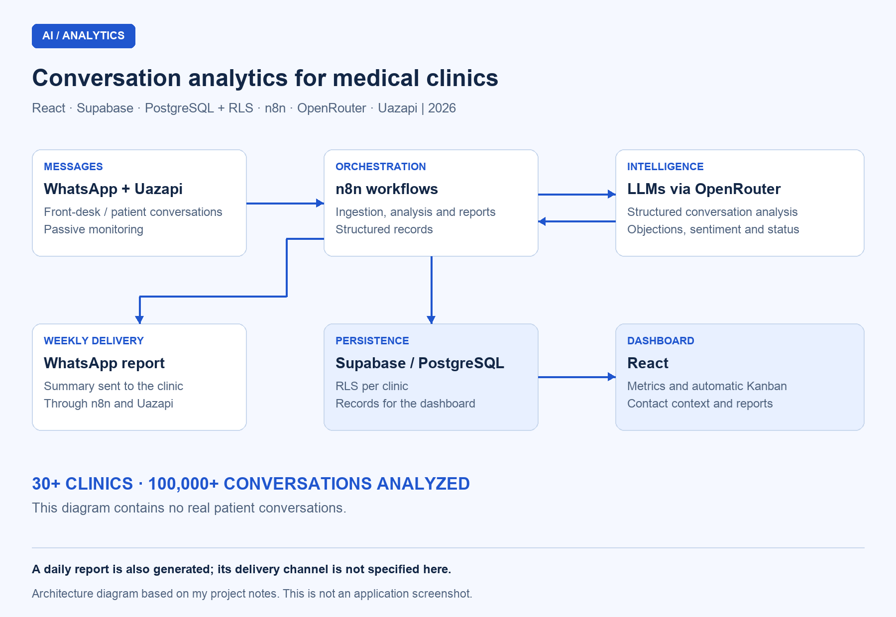

# WhatsApp conversation analytics for medical clinics

## Overview

I built a conversation intelligence system for a **healthtech client in 2026**. It passively monitors WhatsApp conversations between front-desk staff and patients, turning them into structured data, service metrics, an automated Kanban CRM, and management reports.

I developed the project end to end, from the architecture and AI pipeline to the backend and frontend. The system serves **more than 30 clinics** and has analyzed **more than 100,000 conversations**.

This is a proprietary project. I describe how it works and the technical decisions behind it here, without publishing the application's source code.

## The problem

Clinics received leads through WhatsApp, but managers had limited visibility into those conversations: how long front-desk staff took to respond, which objections kept coming up, which channels and insurance plans were associated with conversions, and where contacts dropped out.

I set out to organize that information from the conversations themselves, reducing the need to review each interaction manually.

## My role

I was the **sole developer**. I designed the architecture and service integrations, built the ingestion and AI analysis pipeline, and developed the backend and data structure. I also built the React interface for reviewing metrics, contacts, the Kanban board, and reports.

## Stack and architecture

| Layer | Technology | Responsibility |
| --- | --- | --- |
| Frontend | React | Metrics, contacts, Kanban board, and reports |
| Messaging integration | Uazapi | Connection to the clinic's existing WhatsApp number |
| Orchestration | n8n | Ingestion, structured analysis, and report generation |
| AI | LLMs through OpenRouter | Conversation interpretation and extraction of service information |
| Storage and clinic-level access | Supabase, PostgreSQL, and RLS | Records and access policies for each clinic's data |

## Diagram

### Ingestion, analysis, and delivery architecture

This diagram summarizes the functional flow; it is not an interface screenshot. The arrows do not detail endpoints or access policies.

## Components and responsibilities

### 1. Conversation monitoring and ingestion

I connected the clinic's WhatsApp account through Uazapi and routed conversation content to n8n workflows. Monitoring is passive: it observes existing exchanges between front-desk staff and patients to provide context for analysis.

### 2. Structured AI analysis

I built workflows that turn messages into information managers can review and compare. The analysis identifies:

- Objections, lead sources, common requests, and complaints.
- Lead qualification, follow-up counts, and contact status.
- Peak hours and average response time.
- Conversions by insurance plan, source, and location.

The workflows access models through OpenRouter and organize the results for storage and display.

### 3. Automated Kanban CRM

I implemented a Kanban board that moves contacts between stages based on conversation analysis: **in contact, scheduled, follow-up, canceled, lost, and other**. This gives the clinic a view of its pipeline without relying solely on manual card updates.

### 4. Individual contact reports

I brought the context of each interaction into a report containing a conversation summary, the patient's sentiment toward the service, response time, name, phone number, source, and full context.

### 5. Daily summaries and weekly delivery

I generate daily reports with a summary of the day, recurring objections, opportunities to improve service, and critical situations. For weekly monitoring, the system sends a report directly to the clinic through WhatsApp.

## Technical decisions

| Decision | Why I chose it |
| --- | --- |
| n8n for orchestration | Make ingestion, analysis, and reporting workflows easier to iterate on and maintain |
| OpenRouter for model access | Choose models based on the cost and quality each task requires |
| PostgreSQL with Supabase RLS | Organize data and apply clinic-level access policies in a multi-tenant system |
| Uazapi for messaging | Connect the clinic's existing number through a QR code without migration; this integration does not use Meta's official API |

## Data protection and organization

I used **Supabase RLS** to restrict access to each clinic's own records, **encryption for sensitive data**, and **consent flows** for data processing.

This documentation does not detail the encryption algorithms, retention policies, or any data masking before content is sent to models.

The diagram shows architecture only, with no real patient names, phone numbers, or conversations.

## Results

- More than **30 clinics served**.
- More than **100,000 conversations analyzed**.
- Service metrics, individual contact context, automated Kanban, and recurring reports in one system.
