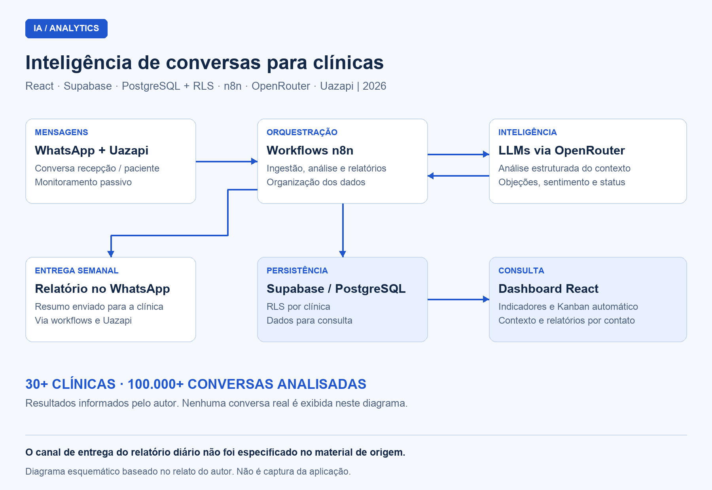

# Inteligência de Conversas de WhatsApp para Clínicas — CRM automático e relatórios com IA

## Visão geral

Desenvolvi um sistema de inteligência de conversas para um cliente do setor de **healthtech, em 2026**. A solução acompanha passivamente as mensagens trocadas entre recepções e pacientes no WhatsApp e as transforma em dados estruturados, indicadores de atendimento, um CRM com Kanban automático e relatórios gerenciais.

Fiz o projeto de ponta a ponta, da arquitetura e do pipeline de IA ao backend e à interface. A solução atende **mais de 30 clínicas** e já analisou **mais de 100.000 conversas**.

É um projeto proprietário. Apresento aqui seu funcionamento e suas decisões técnicas, sem publicar o código-fonte da aplicação.

## Contexto e problema

As clínicas recebiam leads pelo WhatsApp, mas seus gestores tinham pouca visibilidade sobre o atendimento: quanto tempo a recepção levava para responder, quais objeções se repetiam, quais canais e convênios estavam associados às conversões e em que pontos os contatos se perdiam.

Minha proposta foi organizar essas informações a partir das próprias conversas, reduzindo a necessidade de acompanhar manualmente cada atendimento.

## Minha atuação

Atuei como **desenvolvedor solo**. Fui responsável pela arquitetura e pelas integrações entre os serviços, pelo pipeline de ingestão e análise com IA, pelo backend e pela organização dos dados. Também desenvolvi a interface React para consultar indicadores, contatos, Kanban e relatórios.

## Stack e arquitetura

| Camada | Tecnologia | Responsabilidade |
| --- | --- | --- |
| Interface | React | Apresentação dos indicadores, contatos, Kanban e relatórios |
| Integração de mensagens | Uazapi | Conexão com o WhatsApp utilizado pela clínica |
| Orquestração | n8n | Ingestão, análise estruturada e geração de relatórios |
| Inteligência artificial | LLMs via OpenRouter | Interpretação das conversas e extração das informações de atendimento |
| Persistência e acesso por clínica | Supabase, PostgreSQL e RLS | Armazenamento dos registros e políticas de acesso aos dados de cada clínica |

## Diagrama

### Arquitetura de ingestão, análise e entrega

O diagrama resume o fluxo funcional da solução; não é uma captura da interface. As setas não detalham endpoints nem políticas de acesso.

## Componentes e responsabilidades

### 1. Monitoramento e ingestão de conversas

Conectei o WhatsApp da clínica pela Uazapi e encaminhei o conteúdo das conversas aos workflows do n8n. Esse acompanhamento é passivo: observa os atendimentos já realizados entre a recepção e os pacientes para fornecer contexto às análises.

### 2. Análise estruturada com IA

Construí os workflows para transformar as mensagens em informações que a gestão possa consultar e comparar. A análise identifica:

- Objeções, origem do lead, principais procuras e queixas.
- Qualificação, quantidade de retornos e status do contato.
- Horários de pico e tempo médio de resposta.
- Conversões por convênio, origem e localização.

Os workflows acessam os modelos via OpenRouter e organizam os resultados para armazenamento e apresentação.

### 3. CRM com Kanban automático

Implementei um Kanban em que os contatos mudam de etapa com base na análise das conversas: **em contato, agendado, retorno, desmarcado, perdido e outro**. Assim, a clínica acompanha o funil sem depender apenas da atualização manual dos cards.

### 4. Relatório individual por contato

Reuni o contexto de cada atendimento em um relatório com resumo da conversa, sentimento do paciente em relação ao serviço, tempo de resposta, nome, telefone, origem e contexto completo.

### 5. Consolidação diária e entrega semanal

Gero relatórios diários com resumo do dia, principais objeções, oportunidades de melhoria e situações críticas. Para o acompanhamento semanal, a solução envia um relatório pelo WhatsApp diretamente à clínica.

## Decisões técnicas

| Decisão | Por que escolhi |
| --- | --- |
| n8n na orquestração | Facilitar a evolução dos fluxos de ingestão, análise e relatórios e a manutenção dos workflows |
| OpenRouter para acesso aos modelos | Escolher modelos conforme o custo e a qualidade necessários em cada tarefa |
| PostgreSQL com RLS no Supabase | Organizar os dados e aplicar políticas de acesso por clínica em uma estrutura com múltiplos clientes |
| Uazapi na integração de mensagens | Conectar o número já utilizado pela clínica via QR code, sem migração; essa integração não utiliza a API oficial da Meta |

## Proteção e organização dos dados

Adotei **RLS no Supabase** para restringir o acesso aos registros da própria clínica, **criptografia de dados sensíveis** e **fluxos de consentimento** para o tratamento dos dados.

Esta documentação não detalha os algoritmos de criptografia, as políticas de retenção nem eventual mascaramento de dados antes do envio aos modelos.

O diagrama apresenta apenas a arquitetura, sem nomes, telefones ou conversas reais de pacientes.

## Resultados

- Mais de **30 clínicas atendidas**.
- Mais de **100.000 conversas analisadas**.
- Indicadores, contexto por contato, Kanban automático e relatórios periódicos reunidos na mesma solução.
