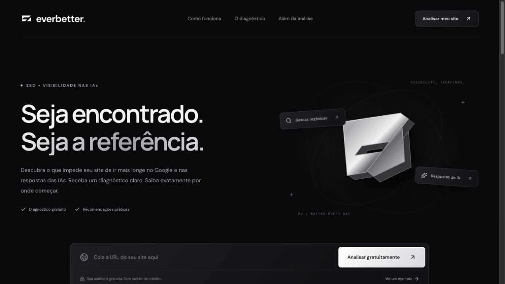

# EverBetter — SEO Diagnostics and Page Readiness for AI Systems

## Overview

I created **EverBetter** to inspect public web pages and show what could be improved in their SEO and how their content is organized for AI systems to interpret. The application takes a URL, inspects its HTML, and brings together evidence, priorities, and recommendations in a report users can review, copy, and print.

This is my own project, and it is live in production. Technical inspection works independently; AI interpretation adds to the report when the OpenRouter integration is configured.

**Live project:** [betterever.tedsptech.com](https://betterever.tedsptech.com/).

## The problem

Technical reports do not always make it clear what was found, what to do about it, or where to start. I wanted to put those pieces together in a report organized by category, connecting each recommendation to evidence from the page.

## My role

I developed the interface and visual identity, page inspection logic, AI model integration, data persistence, admin panel, and deployment setup.

## Project images

### Public page in production

Screenshot of the public page, with the interface in Portuguese. The sample assessment shown on the site is labeled as an example, separate from analyses of URLs submitted by users.

## Stack and architecture

| Layer | Technology / resource | Responsibility |
| --- | --- | --- |
| Frontend | React and TypeScript | URL input, report presentation, and navigation |
| Application and server | Vinext and Node.js | HTTP routes, analysis processing, and admin operations |
| Technical inspection | HTML parser and custom rules | Signal extraction and evaluation of observed criteria |
| AI interpretation | OpenRouter | Additional recommendations when the integration is configured |
| Persistence | SQLite and SQL migrations | Settings, optimization inquiries, and administrative data |
| Deployment | Docker, Coolify, and an HTTPS proxy | Running the application and preserving production data |

**Main flow:** public URL → validation and HTML retrieval → technical inspection → optional AI interpretation → report with evidence and priorities.

## Components and responsibilities

### 1. URL input and inspection

I implemented URL validation and retrieval of public HTML. Inspection covers titles, descriptions, headings, language, canonical links, indexing directives, image alt text, structured data, and contextual and contact information.

### 2. Diagnosis and prioritization

I organized the criteria into four groups: **SEO, AI context, content, and technical factors**. Each item includes evidence, recommendations, priority, effort, and the expected qualitative benefit.

The report distinguishes observed criteria from items that still need confirmation. Its score summarizes the checks performed on the page.

### 3. AI interpretation

I integrated OpenRouter to add explanations and recommendations when that option is configured. If AI is not enabled or the provider fails, the application still delivers the technical inspection and identifies which mode was used.

### 4. Reviewing and sharing reports

I added criteria filters and options to copy and print the assessment. I also included an illustrative example so visitors can see how the application works before submitting their own URL.

### 5. Commercial inquiries and administration

I built a consent-based form for optimization inquiries and an admin panel with its own authentication. From the panel, I can configure copy, the offer, the AI model, and its instructions without editing the public interface.

The assessment is free. I present the optional implementation service separately, alongside an offer for design improvements and local competitor research.

## Technical decisions

| Decision | Why I chose it |
| --- | --- |
| Separate technical inspection from AI interpretation | Keep checks available even when the AI integration is not enabled |
| Show evidence next to each recommendation | Connect the suggested action to what was observed in the HTML |
| SQLite with persistent data | Preserve settings and inquiries between deployments |
| A custom admin panel | Allow content and configuration changes without editing the public interface |
| Container deployment | Organize deployment and operation on the VPS |

## Scope of the assessment

Analysis uses the **HTML of the submitted URL**. It does not execute the page's JavaScript or crawl the entire site. It also does not measure Core Web Vitals, backlinks, search rankings, or citations in AI-generated answers.

The score is heuristic: it summarizes the implemented checks. Recommendations are not forecasts of traffic or rankings.

## Delivery

- My own application, running in production.
- Public URL diagnostics with evidence and priorities.
- Optional AI integration, with technical inspection remaining available.
- Report viewing, copying, and printing.
- Optimization inquiries and settings administration.
