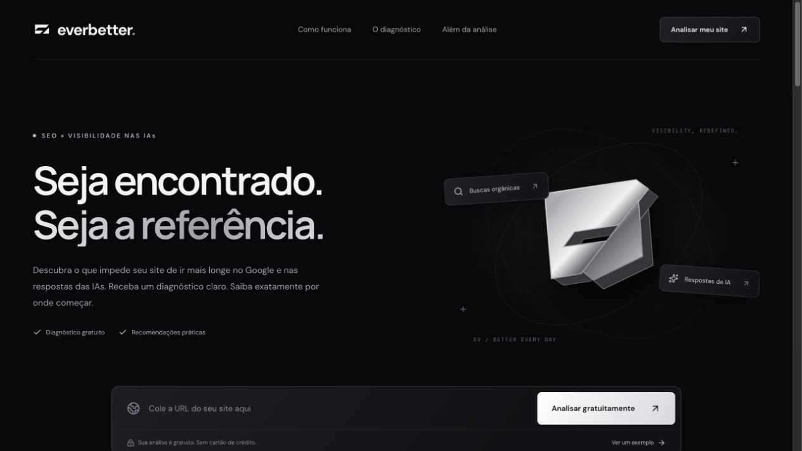

# EverBetter — diagnóstico de SEO e preparação de páginas para sistemas de IA

## Visão geral

Criei o **EverBetter** para diagnosticar páginas públicas e mostrar o que pode ser melhorado em SEO e na organização do conteúdo para interpretação por sistemas de IA. A aplicação recebe uma URL, inspeciona seu HTML e reúne evidências, prioridades e recomendações em um relatório que o usuário pode consultar, copiar e imprimir.

O projeto é autoral e está em produção. A inspeção técnica funciona de forma independente; a interpretação por IA complementa o relatório quando a integração com o OpenRouter está configurada.

**Acessar o projeto:** [betterever.tedsptech.com](https://betterever.tedsptech.com/).

## Contexto e problema

Relatórios técnicos nem sempre deixam claro o que foi encontrado, qual ação tomar e por onde começar. Quis reunir essas informações em um diagnóstico organizado por categorias, ligando cada recomendação às evidências observadas na página.

## Minha atuação

Desenvolvi a interface e a identidade visual, a inspeção técnica das páginas, a integração com modelos de IA, a persistência de dados, o painel administrativo e a estrutura de publicação da aplicação.

## Imagens do projeto

### Página pública em produção

Captura da página pública. O diagnóstico ilustrativo mostrado no site é identificado como exemplo, separado das análises de URLs enviadas pelo usuário.

## Stack e arquitetura

| Camada | Tecnologia / recurso | Responsabilidade |
| --- | --- | --- |
| Interface | React e TypeScript | Entrada da URL, apresentação e navegação do relatório |
| Aplicação e servidor | Vinext e Node.js | Rotas HTTP, processamento da análise e operação do painel |
| Inspeção técnica | Parser de HTML e regras próprias | Extração de sinais e geração dos critérios observados |
| Interpretação por IA | OpenRouter | Complementação das recomendações quando a integração está configurada |
| Persistência | SQLite e migrações SQL | Configurações, solicitações de interesse e dados administrativos |
| Publicação | Docker, Coolify e proxy HTTPS | Execução da aplicação e persistência dos dados em produção |

**Fluxo principal:** URL pública → validação e obtenção do HTML → inspeção técnica → interpretação opcional por IA → relatório com evidências e prioridades.

## Componentes e responsabilidades

### 1. Recebimento e inspeção da URL

Implementei a validação da URL e a obtenção de seu HTML público. A inspeção observa títulos, descrições, headings, idioma, canonical, diretivas de indexação, textos alternativos de imagens, dados estruturados e sinais de contexto e contato.

### 2. Diagnóstico e priorização

Organizei os critérios em quatro grupos: **SEO, contexto para IAs, conteúdo e aspectos técnicos**. Cada item apresenta evidências, recomendações, prioridade, esforço e benefício qualitativo esperado.

O relatório diferencia o que foi observado do que ainda precisa de confirmação. O índice resume as verificações da página analisada.

### 3. Interpretação por IA

Integrei o OpenRouter para complementar as explicações e recomendações quando essa opção está configurada. Se a IA não estiver ativa ou o provedor falhar, a aplicação entrega a inspeção técnica e informa o modo utilizado.

### 4. Consulta e compartilhamento do relatório

Incluí filtros por critérios e opções de cópia e impressão do diagnóstico. Também disponibilizei um exemplo ilustrativo para que o visitante conheça o funcionamento antes de analisar uma URL própria.

### 5. Interesse comercial e administração

Implementei um formulário com consentimento para receber solicitações de otimização e um painel com autenticação própria. Nele, posso configurar textos, oferta, modelo e instruções de IA sem editar a interface pública.

O diagnóstico é gratuito. Apresento separadamente o serviço opcional de execução das melhorias, além de uma oferta de melhoria de design e estudo da concorrência local.

## Decisões técnicas

| Decisão | Por que escolhi |
| --- | --- |
| Separar inspeção técnica e interpretação por IA | Manter as verificações disponíveis mesmo sem a integração de IA ativa |
| Mostrar evidência junto da recomendação | Relacionar a ação sugerida ao que foi observado no HTML |
| SQLite com dados persistentes | Preservar configurações e solicitações entre publicações |
| Painel administrativo próprio | Permitir ajustes de conteúdo e configuração sem editar a interface pública |
| Execução em container | Organizar a publicação e a operação da aplicação na VPS |

## Escopo do diagnóstico

A análise usa o **HTML da URL informada**. Não executa o JavaScript da página nem rastreia o site inteiro. Também não mede Core Web Vitals, backlinks, posições nos buscadores ou citações em respostas de IA.

A nota é heurística: resume as verificações implementadas. As recomendações não representam previsão de tráfego ou ranking.

## Entrega

- Aplicação autoral disponível em produção.
- Diagnóstico de URLs públicas com evidências e priorização.
- Integração opcional com IA, mantendo a inspeção técnica disponível.
- Consulta, cópia e impressão dos relatórios.
- Recebimento de solicitações de otimização e administração das configurações.
