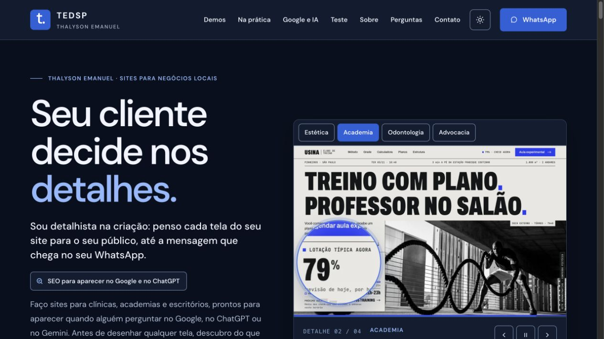

# Landpages — Local Business Websites with Four Interactive Demos

## Overview

I created **Landpages** to showcase websites and landing pages for local businesses through **four working demos**: aesthetics, fitness, dentistry, and law. The project is live in production and combines interface studies, interactive tools, and user flows that prepare WhatsApp messages based on visitors' choices.

**Live project:** [landpages.tedsptech.com](https://landpages.tedsptech.com/).

The demos are concept projects. Their brands, people, addresses, and figures are fictional.

## The problem

A local business website needs to answer its audience's questions and help visitors take the next step. With Landpages, I explored how visual identity, content, and interactions can change with the business category and the visitor's intent.

I wanted people to try the flows rather than judge screenshots alone, and to show how choices made on a website can give context to the first message sent to a business.

## My role

I researched the audiences, defined the user flows, and wrote the copy. I also developed each demo's visual identity, implemented the pages and interactions, prepared the demonstration materials, and deployed the project.

## Project images

### Public portfolio in production

Screenshot of the live application, with the interface in Portuguese. The examples belong to the demos' fictional brands.

## Stack and architecture

| Layer | Technology / resource | Responsibility |
| --- | --- | --- |
| Structure | Semantic HTML | Page content, sections, and organization |
| Presentation | Responsive CSS | A visual identity for each business category and layouts for desktop and mobile |
| Interactions | JavaScript | Selectors, simulators, forms, and message composition |
| Demonstration | Iframes and preview images | Trying demos inside the portfolio and opening them full-screen |
| Contact | WhatsApp links | Opening messages with the context selected by the visitor |
| Discovery | Metadata and JSON-LD structured data | Representing the demo businesses' content and information |
| Deployment | Nginx, Docker, and Coolify | Serving static pages on the public domain |

**Main flow:** choose a business category → explore and try the demo → make selections → open the prepared message in WhatsApp.

## Demos and responsibilities

### 1. Nuance Estética

I developed an assessment-request flow for people researching aesthetic procedures. It includes an interactive map of facial areas, options to explore, and a prepared request containing the visitor's selected area, day, and time.

### 2. Usina Clube de Treino

I built an experience for exploring a gym and planning a workout. I implemented an illustrative occupancy display, a weight-plate calculator and load estimate, class and membership filters, and a flow for preparing trial-class requests.

Occupancy figures and the brand's other data are for demonstration purposes.

### 3. Alvor Odontologia

I organized information and interactions for people researching dental treatments. The demo includes a visual presentation of smile planning and an illustrative tooth-shade scale.

Its contact options capture visitors' preferences, including a more gradual approach for people who feel anxious about dental care.

### 4. Ferraz Lobato Advogados

I developed a law firm's presentation and initial inquiry flow. I included a deadline simulator, an indication of the next response window, and a prepared message containing information selected during the visit.

The simulators demonstrate the interface and do not replace a professional assessment of an actual case.

## Shared features

- Business category selection, a details carousel, and page previews in the portfolio.
- Demos that visitors can try within the page or open full-screen.
- Comparisons between a generic message and one prepared through the interactions.
- Light and dark themes with the visitor's preference saved.
- Responsive navigation and copy organized for each audience.
- Metadata, semantic HTML, and structured data on the demo pages.
- A commercial inquiry flow that asks for the business type and composes a WhatsApp message.

The page prepares the message but **does not send it automatically**. Visitors open WhatsApp and decide whether to send it. The demos also do not make real bookings in clinic or business calendars.

## Technical decisions

| Decision | Why I chose it |
| --- | --- |
| A distinct identity for each business category | Explore different needs for content, trust, and interaction |
| Working demos alongside screenshots | Let visitors try and evaluate the user flows |
| Contextual WhatsApp messages | Carry choices made on the page into the initial inquiry |
| Static pages with JavaScript | Build and serve the demos without a transactional backend |
| Clear identification of concept projects | Distinguish the demos from work completed for real clients |

## Delivery

- My own live portfolio with four demos for different business categories.
- Interactive features and test walkthroughs available to visitors.
- Presentation of UX, content, and implementation decisions.
- A contact channel for local business website projects.

I do not attribute conversion metrics or commercial results to the demos' fictional brands.
