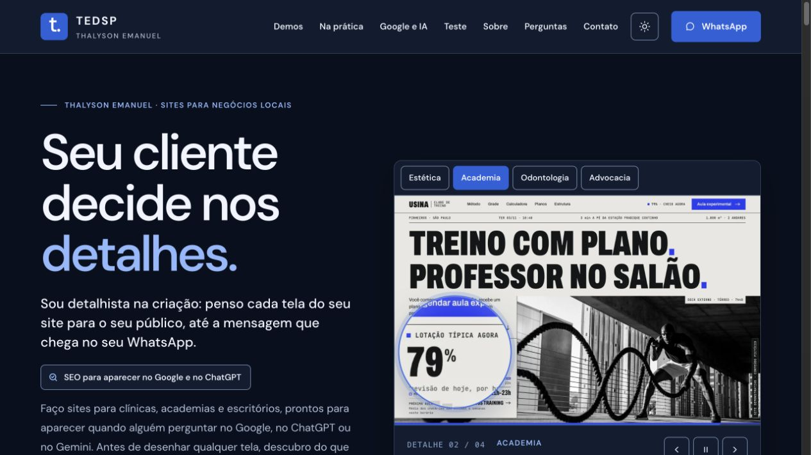

# Landpages — sites para negócios locais com quatro demos interativas

## Visão geral

Criei o **Landpages** para apresentar sites e landing pages para negócios locais por meio de **quatro demos navegáveis**: estética, academia, odontologia e advocacia. O projeto está em produção e reúne estudos de interface, ferramentas interativas e jornadas que preparam mensagens de WhatsApp a partir das escolhas do visitante.

**Acessar o projeto:** [landpages.tedsptech.com](https://landpages.tedsptech.com/).

As demos são projetos-conceito. Suas marcas, pessoas, endereços e números são fictícios.

## Contexto e problema

Um site para um negócio local precisa esclarecer as dúvidas do público e ajudar no próximo passo do contato. No Landpages, explorei como a identidade visual, o conteúdo e as interações podem mudar conforme o segmento e a intenção do visitante.

Quis permitir que as pessoas percorressem as jornadas, em vez de avaliarem apenas imagens das páginas, e mostrar como as escolhas feitas no site podem dar contexto à primeira mensagem enviada à empresa.

## Minha atuação

Fiz a pesquisa de público, defini as jornadas e escrevi os textos. Também desenvolvi a identidade visual de cada demo, implementei as páginas e interações, preparei os materiais de demonstração e publiquei o projeto.

## Imagens do projeto

### Portfólio público em produção

Captura da aplicação publicada. Os exemplos apresentados pertencem às marcas fictícias das demos.

## Stack e arquitetura

| Camada | Tecnologia / recurso | Responsabilidade |
| --- | --- | --- |
| Estrutura | HTML semântico | Conteúdo, seções e organização das páginas |
| Apresentação | CSS responsivo | Identidade visual por segmento e adaptação a computador e celular |
| Interações | JavaScript | Seletores, simuladores, formulários e composição das mensagens |
| Demonstração | Iframes e imagens de prévia | Teste das demos no portfólio e abertura em tela cheia |
| Contato | Links de WhatsApp | Abertura de mensagens com o contexto selecionado pelo visitante |
| Descoberta | Metadados e dados estruturados JSON-LD | Representação do conteúdo e das informações dos negócios de demonstração |
| Publicação | Nginx, Docker e Coolify | Entrega das páginas estáticas no domínio público |

**Fluxo principal:** seleção do segmento → consulta e teste da demo → escolhas do visitante → mensagem preparada para abrir no WhatsApp.

## Demos e responsabilidades

### 1. Nuance Estética

Desenvolvi uma jornada de avaliação para quem pesquisa procedimentos estéticos. Ela inclui um mapa interativo de regiões do rosto, consulta das opções e preparação de um pedido de avaliação com região, dia e horário escolhidos pelo visitante.

### 2. Usina Clube de Treino

Criei uma experiência para conhecer a academia e planejar o treino. Implementei uma visualização ilustrativa de lotação, calculadora de anilhas e estimativa de carga, filtros de modalidades e planos e preparação de pedidos de aula experimental.

Os números de ocupação e os demais dados da marca são demonstrativos.

### 3. Alvor Odontologia

Organizei informações e interações para quem pesquisa tratamentos odontológicos. A demo apresenta visualmente o planejamento do sorriso e uma escala ilustrativa de tonalidades.

As opções de contato registram as preferências do visitante, incluindo uma abordagem mais gradual para quem tem receio do atendimento.

### 4. Ferraz Lobato Advogados

Desenvolvi a apresentação de um escritório e a jornada de primeiro contato. Incluí um simulador de prazos, a indicação do próximo período de resposta e a preparação de uma mensagem com as informações selecionadas ao longo da navegação.

Os simuladores demonstram a interface e não substituem a avaliação profissional de um caso concreto.

## Recursos compartilhados

- Seleção de segmento, carrossel de detalhes e visualização das páginas no portfólio.
- Demos que podem ser testadas dentro da página ou abertas em tela cheia.
- Comparações entre uma mensagem genérica e a mensagem preparada pelas interações.
- Temas claro e escuro com a preferência salva.
- Navegação responsiva e textos organizados para cada público.
- Metadados, HTML semântico e dados estruturados nas páginas de demonstração.
- Contato comercial com escolha do tipo de negócio e montagem da mensagem de WhatsApp.

A página prepara a mensagem, mas **não a envia automaticamente**. O visitante abre o WhatsApp e decide enviá-la. As demos também não realizam reservas em agendas de clínicas ou empresas.

## Decisões técnicas

| Decisão | Por que escolhi |
| --- | --- |
| Identidade própria para cada segmento | Explorar necessidades diferentes de conteúdo, confiança e interação |
| Demos utilizáveis, além das imagens | Permitir que o visitante percorra e avalie as jornadas |
| Mensagem de WhatsApp contextualizada | Levar as escolhas feitas na página para o início do contato |
| Páginas estáticas com JavaScript | Construir e servir as demonstrações sem um backend transacional |
| Identificação explícita dos projetos-conceito | Distinguir as demos de trabalhos realizados para clientes reais |

## Entrega

- Portfólio autoral em produção com quatro demos de segmentos diferentes.
- Interações e roteiros de teste disponíveis ao visitante.
- Apresentação das decisões de UX, conteúdo e implementação.
- Canal de contato para desenvolvimento de sites para negócios locais.

Não atribuo métricas de conversão ou resultados comerciais às marcas fictícias das demos.
