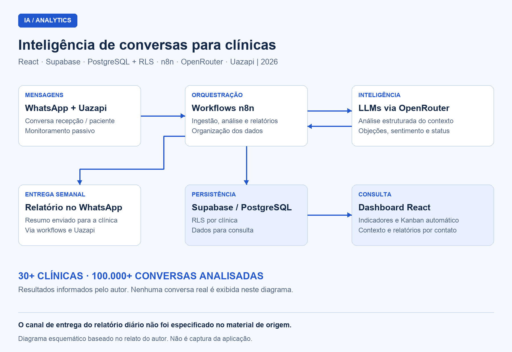

## Visão geral

Sistema de inteligência de conversas desenvolvido por **Thalyson Emanuel para um cliente do setor de healthtech, em 2026**. A solução monitora passivamente conversas de WhatsApp entre recepções e pacientes e as transforma em dados estruturados, indicadores de atendimento, um CRM com Kanban automático e relatórios gerenciais.

O projeto foi desenvolvido de ponta a ponta, da arquitetura e do pipeline de IA ao backend e à interface. Segundo o relatório do autor, a solução atende **mais de 30 clínicas** e já analisou **mais de 100.000 conversas**.

Projeto proprietário, apresentado por meio de documentação funcional e técnica. O código-fonte da aplicação não é publicado nesta documentação.

## Contexto e problema

As clínicas recebiam leads pelo WhatsApp, mas os gestores tinham pouca visibilidade sobre o atendimento: tempo de resposta da recepção, objeções recorrentes, canais e convênios associados às conversões e pontos em que os contatos se perdiam.

A proposta foi organizar essas informações a partir das próprias conversas, reduzindo a dependência de acompanhamento manual de cada atendimento.

## Minha atuação

**Desenvolvedor solo**, responsável por:

- Arquitetura da solução e conexão entre os serviços.
- Pipeline de ingestão e análise das conversas com IA.
- Desenvolvimento do backend e organização dos dados.
- Desenvolvimento da interface React para consulta dos indicadores e registros.

## Stack e arquitetura

| Camada | Tecnologia | Responsabilidade no projeto |
| --- | --- | --- |
| Interface | React | Apresentação dos indicadores, contatos, Kanban e relatórios |
| Integração de mensagens | Uazapi | Conexão com o WhatsApp utilizado pela clínica |
| Orquestração | n8n | Ingestão, análise estruturada e geração de relatórios |
| Inteligência artificial | LLMs via OpenRouter | Interpretação das conversas e extração das informações de atendimento |
| Persistência e acesso por clínica | Supabase, PostgreSQL e RLS | Armazenamento dos registros e políticas de acesso aos dados de cada clínica |

## Diagramas

### Arquitetura de ingestão, análise e entrega

Diagrama esquemático baseado na descrição do projeto; não é captura da interface. As setas representam o fluxo funcional resumido, sem detalhar endpoints ou políticas de acesso.

## Componentes e responsabilidades

### 1. Monitoramento e ingestão de conversas

**Objetivo:** reunir o contexto dos contatos a partir das mensagens trocadas entre a recepção e os pacientes.

**Principais funções:** conectar o WhatsApp pela Uazapi, receber o conteúdo das conversas e encaminhá-lo aos workflows do n8n.

**Comportamento:** acompanha passivamente os atendimentos existentes e fornece o conteúdo necessário para as etapas de análise.

### 2. Análise estruturada com IA

**Objetivo:** transformar conversas em informações que possam ser consultadas e comparadas pela gestão.

**Principais funções:** identificar objeções, origem do lead, principais procuras e queixas, qualificação, quantidade de retornos e status do contato. A análise também reúne informações para avaliar horários de pico, tempo médio de resposta e conversões por convênio, origem e localização.

**Comportamento:** os workflows do n8n utilizam modelos acessados via OpenRouter e organizam a saída para persistência e apresentação.

### 3. CRM com Kanban automático

**Objetivo:** manter uma visão do estágio de cada contato com base na conversa.

**Etapas informadas:** em contato, agendado, retorno, desmarcado, perdido e outro.

**Comportamento:** os contatos são movimentados entre essas etapas a partir da análise das mensagens, compondo uma visão operacional do funil.

### 4. Relatório individual por contato

**Objetivo:** permitir a consulta do contexto de um atendimento específico.

**Informações reunidas:** resumo da conversa, sentimento do paciente em relação ao atendimento, tempo de resposta, nome, telefone, origem e contexto completo.

### 5. Consolidação diária e entrega semanal

**Objetivo:** transformar as análises em acompanhamento periódico da operação.

**Principais funções:** gerar o resumo do dia, reunir as principais objeções, apontar oportunidades de melhoria e destacar situações críticas.

**Comportamento:** a solução produz relatórios diários e envia um relatório semanal via WhatsApp para a clínica. O relatório de origem não especifica o canal de entrega do relatório diário.

## Decisões técnicas

| Decisão | Motivo descrito no projeto |
| --- | --- |
| n8n na orquestração | Facilitar a iteração dos fluxos de ingestão, análise e relatórios e a manutenção dos workflows |
| OpenRouter para acesso aos modelos | Permitir a escolha de modelos conforme a relação entre custo e qualidade de cada tarefa |
| PostgreSQL com RLS no Supabase | Organizar os dados e aplicar políticas de acesso por clínica em uma estrutura com múltiplos clientes |
| Uazapi na integração de mensagens | Conectar o número já utilizado pela clínica via QR code, sem migração; o projeto descreve essa integração como alternativa à API oficial da Meta |

## Proteção e organização dos dados

O relatório do autor informa três recursos adotados no projeto:

- **RLS no Supabase:** políticas para restringir o acesso aos registros da própria clínica.
- **Criptografia de dados sensíveis.**
- **Fluxos de consentimento para tratamento dos dados.**

Os algoritmos de criptografia, as políticas detalhadas de retenção e o eventual mascaramento de dados antes do envio aos modelos não foram especificados no material recebido.

As imagens desta documentação contêm apenas arquitetura esquemática, sem nomes, telefones ou conversas reais de pacientes.

## Resultados

- Mais de **30 clínicas atendidas**.
- Mais de **100.000 conversas analisadas**.
- Indicadores de atendimento, contexto por contato, Kanban automático e relatórios periódicos reunidos na solução.

Os números foram fornecidos pelo autor no relatório do projeto.
